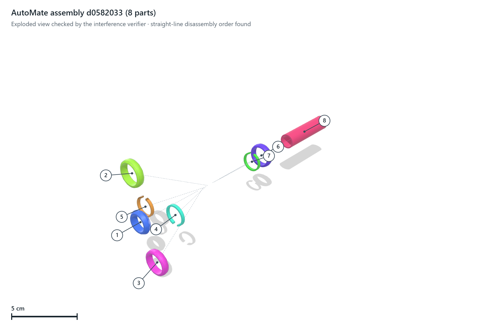

# cad-exploded-view-studio

**Status: prototype.** A local 3D studio that opens a STEP assembly, computes an exploded view **checked by a geometric verifier**, animates it (all at once or part by part) and exports it as a PNG or as a standalone HTML page that opens without a server.



*PNG export of the studio for a real assembly from the AutoMate dataset (Jones et al., 2021, CC0), loaded from the examples of the verifier repository. The final layout passed the interference verifier after one axial-spreading pass. A straight-line order exists to take all 8 parts apart. Numbered balloons, dashed motion paths and the scale bar are drawn by the studio.*

All computations come from [cad-exploded-view-verifier](https://github.com/ayoub-elkhader/cad-exploded-view-verifier). The studio adds the scheduling, the verdicts shown to the user and the 3D interface. It runs on `127.0.0.1` only and makes no network or LLM call.

## What the studio computes for an assembly

A worker process does the work, one model at a time, with a 30-minute limit by default:

1. **Exploded layout**: centroid explosion, then axial spreading, then a seeded random repair if conflicts remain. The final layout is checked by the interference verifier. If any pair is undetermined, the layout is not accepted.
2. **"All at once"**: the verifier runs at 24 fractions of the displacement, and the slider shows from which fraction every sampled state is conflict-free. "Compact view" jumps to the smallest checked fraction, plus a margin.
3. **"Part by part"**: the straight-line sequential disassembly test is run, with a feasibility repair if needed. The studio then looks for a deterministic order in which the *displayed* motion of each part crosses no part already removed. If no such order exists, the animation is not played and the studio says why.

Every verdict appears in the *Checks* tab, together with the origin of the plan and the scope of the checks.

## Interface

- trackball rotation in every direction, pan, zoom to the cursor, preset views (ISO, front, top…), keyboard shortcuts;
- bill of materials with item balloons and CSV export. A mass is shown only when a material is declared; nothing is guessed;
- colour per part / by declared material / technical grey; Z-up or Y-up files; trajectory lines; isolate and ghost modes;
- **sharing**: a high-resolution PNG (3× the screen resolution), or a single self-contained HTML file (three.js, geometry, vectors, bill of materials and verdicts embedded).

## Installation

`pythonocc-core` is distributed through conda-forge only. The environment installs the verifier from GitHub.

```bash
conda env create -f environment.yml
conda activate cad-studio
```

## Usage

```bash
python -m studio.server --port 8780     # or: cad-studio --port 8780
# open http://127.0.0.1:8780
```

The catalogue lists the built-in synthetic samples (`pin_in_plate`, `shaft_stack`, `caged_cube`). Under `models/` (or `CAD_DATA_ROOT`), it also lists:
- Fusion 360 Gallery folders (`<id>/assembly.json`): part names and declared materials are shown, so masses can be computed;
- AutoMate assemblies (`automate_asm/*.json` with their `automate_step/` folder, or `AUTOMATE_STEP_DIR`);
- every other `.step` / `.stp` file.

The datasets are not included. [DATASETS.md](https://github.com/ayoub-elkhader/cad-exploded-view-verifier/blob/main/DATASETS.md) explains how to download them and gives their licenses: Fusion 360 Gallery is for non-commercial research only. Results, snapshots and shared pages are written to `runtime/`, or to `STUDIO_RUNTIME` (see `.env.example`). A model can be opened directly with `?source=sample&case=shaft_stack`.

## Demo

On a real Fusion 360 Gallery assembly (`133099_3ccb3631`, 9 parts, run locally), the worker reads the part names and the declared material (steel), accepts the final view and finds a 9-part disassembly order.

I checked it in a browser on `shaft_stack` (5 parts):
- final view: *Checked*, plan from axial spreading;
- "all at once": conflict-free from 58 % of the displacement;
- disassembly order: 5 parts;
- part-by-part animation: *Checked*.

## Tests

```bash
pytest
```

5 tests pass locally (Windows 10, Python 3.10, pythonocc-core 7.9.0):
- the worker on the three samples and on a STEP file (`caged_cube` correctly gets "no disassembly order");
- catalogue detection and the worker on small files in the Fusion and AutoMate formats (names, declared material, mass);
- the HTTP server end to end: catalogue, computation queue, scene, export of the standalone page, rejection of unknown ids.

CI runs them on Python 3.10–3.12 with conda-forge.

## Limitations

- The limitations of the verifier apply: rigid translations only, discrete sampling of motions, no joints, fasteners or rotations. The interface therefore never says "mechanically guaranteed".
- For plain STEP files, every solid is one part; names and materials are not read. Parts appear as "Solid 1", "Solid 2"… and get no mass.
- Large assemblies can take many minutes. The studio computes one model at a time.
- Local tool: no authentication. Do not expose the port to a network.

## Third-party code

`studio/web/vendor/three.min.js` is three.js r128 (MIT, see `studio/web/vendor/LICENSE.three.txt`).

## License

MIT, see [LICENSE](LICENSE).
